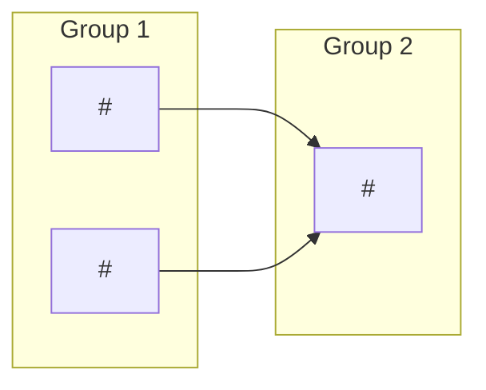

# Split templates

Body templates used by `iru-split-github-issue`. Placeholders are in `<angle brackets>`. Write the issue text in the
language of the original issue.

## Root issue body

````markdown
## Summary
<one or two sentences: the overall goal of the split work>

## Context
<why the work matters; carried over from the original issue>

## Milestone
[<milestone title>](<milestone url>)

## Work breakdown
Issues in the same group are independent and can proceed in parallel. A group starts when every issue of the
previous groups is done.

| Group | Issues | Parallelizable |
|-------|--------|----------------|
| 1 | #<n>, #<m> | yes |
| 2 | #<k> | no |



## Original description
<only when splitting an existing issue: the original body, verbatim>
````

Notes:

- While sub-issues do not exist yet, use placeholders (`#TBD-1`) in the table and the diagram; replace them with real
  numbers once all sub-issues are created.
- If the sub-issues endpoint is unavailable, add under the table a task list `- [ ] #<n> <title>` per sub-issue.
- A one-group split has a single row; the diagram then has no arrows.

## Sub-issue body

````markdown
Parent: #<root>

## Context
<the slice of the parent this issue covers, and why; link to the parent for the overall goal>

## Requirements
- <requirement subset for this slice, testable>

## Acceptance criteria
- <verifiable criterion, traceable to a requirement above>

## Dependencies
Blocked by: #<n>, #<m>
<or: Blocked by: none>

## Parallel group
Parallel group: <n>
````

Notes:

- Include `Technical details` and `Out of scope` sections only if the original issue had content for this slice.
- Every sub-issue must be self-sufficient for `/iru-issue <n>`: Context, Requirements and Acceptance criteria are
  mandatory, even if short.
- `Blocked by` lists the issues of earlier groups this issue really needs, not every earlier issue.
